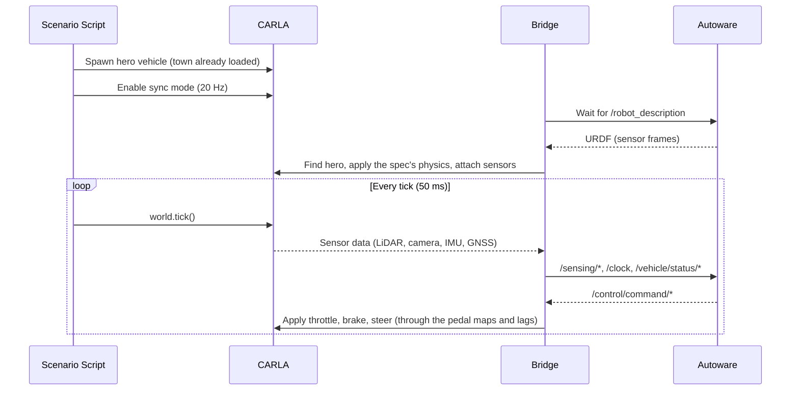

# Autoware CARLA Bridge

Native ROS 2 bridge between [CARLA](https://carla.org/) and [Autoware](https://autowarefoundation.github.io/autoware-documentation/). Written in Rust using [rclrs](https://github.com/ros2-rust/ros2_rust).

acb is CARLA's vehicle interface for Autoware: `acb_bridge` attaches to the CARLA vehicle
whose `role_name` is `hero`, spawns its sensors, publishes them and the vehicle status to
Autoware, and applies Autoware's control. With the two vehicle repositories it builds against
(below) it is a complete Autoware-on-CARLA system: start CARLA, launch, and the car drives
itself to a goal. [scenario-world-bridge](https://github.com/NEWSLabNTU/scenario-world-bridge)
(swb) runs the same bridge as the ego of scenario_simulator_v2 scenarios.

## Key Features

- **Single-process, native ROS 2** -- one Rust process, no multi-process coordination
- **One source of the car** -- sensors, physics and Autoware's vehicle packages are all
  generated from one vehicle spec (`sim_vehicle_spec`); acb checks that they agree
- **The spec's physics on CARLA** -- `acb_bridge` puts the spec's mass, motor, tires and
  brakes on the hero and adds the brake and motor lags CARLA's model lacks
- **Automatic localization** -- GNSS initializes Autoware's NDT localization; no manual pose estimate
- **Synchronous simulation** -- 20 Hz; whoever owns the scene ticks CARLA, the bridge follows
- **One clock** -- stamps and `/clock` are CARLA's simulation time plus a fixed 1000 s
- **Companion tools** -- vehicle monitor GUI, Lanelet2/point cloud map generators, `vehicle-check`

## The car

The car is a vehicle spec, `tesla_model3`, and lives in two repositories that acb carries as
submodules under `deps/`:

| | holds |
|---|---|
| `deps/sim_vehicle_spec` | the spec (`vehicles/tesla_model3.yaml`) and what it generates for CARLA: `generated/tesla_model3/carla_sensors.yaml` (the sensors acb spawns) and `carla_physics.yaml` (the physics acb applies) |
| `deps/autoware_sim_vehicle` | Autoware's packages for the car (`tesla_model3_description`, `_launch`, `_sensor_kit_description`, `_sensor_kit_launch`, `individual_params`), with the measured pedal maps; the Autoware profile for a simulated car (`autoware_sim_profile`); `autoware_sim_pilot` (`auto_drive`, `capture_poses`); `autoware_sim_check` (`vehicle_check`) |

Every launch selects the car with `vehicle_model:=tesla_model3` (the default).

- **Sensors**: the sensor list and blueprint attributes come from `carla_sensors.yaml`
  (parameter `vehicle_config`); their mounts come from Autoware's `/robot_description` (TF).
  A `map_origin` key in that file is refused: the origin is the map's
  (`<map dir>/carla/map_origin.yaml`).
- **Physics** (`carla_physics`, `carla_physics_mode`): `apply` (acb's own launches) puts the
  file on the hero when acb attaches, so a hero spawned by any client becomes the spec's car;
  `verify` (under swb, whose CARLA world server applies it after the spawn) only reads it
  back. In both modes acb refuses a hero of another blueprint than the file's, and a physics
  read-back that differs from the file. `carla_physics:=none` keeps the blueprint's own
  physics (the default of `acb_bridge.launch.xml` alone).
- **Pedal maps**: `accel_map.csv` and `brake_map.csv` in `<car>_description/config/`,
  measured on the spec's physics.
- **spec_hash**: every generated file names the spec it came from. At start acb compares
  the hash in its sensor file with the Autoware package's (`autoware_spec_hash_file`,
  `<car>_description/config/spec_hash.yaml`) and warns when they differ: one of the two
  installs is stale.

## Quick Start

### Prerequisites

- Ubuntu 22.04 + ROS 2 Humble
- Autoware 1.5.0 (the NEWSLabNTU Debian packages, `/opt/autoware/1.5.0`; `just setup` installs them)
- [CARLA 0.9.16](https://carla.org/) installed and running
- CARLA Python API on `PYTHONPATH`
- [Map data](#map-data) downloaded

### Install

Download the latest release tarball from [GitHub Releases](https://github.com/NEWSLabNTU/autoware_carla_bridge/releases) and extract:

```bash
tar -xzf autoware-carla-bridge-0.12.0-x86_64.tar.gz
```

The tarball (`just package`) holds acb's packages and the car's from `deps/`.

### Autoware data directory (once per machine)

Autoware's TensorRT nodes write their built engines next to the model files, so
`data_path` (default `~/autoware_data`) must be a writable directory. Mirror the packaged
models into it once:

```bash
ros2 run autoware_sim_profile setup_autoware_data            # /opt/autoware/1.5.0/data -> ~/autoware_data
ros2 run autoware_sim_profile setup_autoware_data SRC DST    # other locations
```

The profile refuses to start, naming this command, when `data_path` is missing or
read-only -- otherwise those nodes would silently never load.

### Run

Start CARLA, load the town (see [Time and episodes](#time-and-episodes) for why first), then
in another terminal:

```bash
source /opt/autoware/1.5.0/setup.bash
source autoware-carla-bridge-0.12.0/setup.bash

ros2 launch acb_demo_launch single_vehicle_autoware.launch.xml \
    map_path:=/path/to/maps/Town01
```

This launches Autoware, the bridge, and a scenario script that spawns the hero in Town01 and
ticks CARLA. The vehicle appears in RViz and is ready for manual or autonomous control.

### Running Components Separately

```bash
# Terminal 1: Autoware + bridge
ros2 launch acb_launch carla_simulator.launch.xml \
    map_path:=/path/to/maps/Town01

# Terminal 2: scenario script (or any CARLA client that spawns a vehicle with role_name=hero)
ros2 launch acb_scenario single_vehicle_scenario.launch.xml

# Terminal 3 (optional): autonomous driving pilot
ros2 run autoware_sim_pilot auto_drive --ros-args \
    -p poses_file:=$(ros2 pkg prefix autoware_sim_pilot)/share/autoware_sim_pilot/config/poses/Town01.yaml
```

With the pilot, the vehicle localizes from GNSS, follows a preset route, and drives to the goal.

`carla_simulator.launch.xml` is the Autoware profile
(`autoware_sim_profile/launch/autoware.launch.xml`) plus `acb_bridge`. Every argument it
does not declare itself reaches the profile: `max_velocity`, `lidar_detection_model`,
`rviz`, `gpu`, `extra_launch`, and the simulation switches `sim_localization`,
`sim_perception`, `sim_system`, `sim_control`, `sim_planning`, `sim_clock_guard`. The
switches were called `carla_*` before; the profile's `check_launch_args` names the new
name for each old one, but ROS launch itself silently ignores an argument nobody declares,
so `carla_control:=false` given straight to `ros2 launch` has no effect.

### Map Data

Pre-converted Autoware maps (lanelet2 + PCD) for CARLA towns are available from [TUMFTM/carla-autoware-bridge](https://github.com/TUMFTM/carla-autoware-bridge) (`just setup` downloads them to `data/carla-autoware-bridge/`). Each town directory contains:

```
Town01/
  lanelet2_map.osm
  pointcloud_map.pcd
  map_config.yaml
  map_projector_info.yaml
```

Available towns: Town01, Town02, Town03, Town05, Town10HD. A town directory may also hold
`carla/traffic_lights.yaml` (CARLA's signal table, for V2X traffic lights) and
`carla/map_origin.yaml` (where CARLA's origin sits in the map frame; absent means zero, as
for every TUM town).

The pack's lanelets are linked to the wrong traffic lights: on Town01, 34 of 36 lights had
their stop line on the next lane or at another junction, and Autoware drove through CARLA's
red. scenario-world-bridge's `scripts/repair_lanelet_signal_links.py <Town> --port <CARLA
port>` relinks them from CARLA's own stop waypoints (CARLA holding the town, something
ticking it); its user guide lists the other repairs the pack needs.

## Architecture



- **Scenario script** owns the CARLA scene: spawns the hero, runs the tick loop, destroys the hero on exit
- **Bridge** attaches to the hero (it never spawns or destroys it) and owns its sensors
- **One bridge per Autoware instance**; multi-vehicle via separate `ROS_DOMAIN_ID`

## Time and episodes

Every stamp and `/clock` value is `nanos(elapsed_seconds) + BASE_NS`: CARLA's simulation
time of the frame, plus `BASE_NS` = 1000 s, which keeps ROS time away from 0 ("no clock
yet"). There is no epoch and no wall-clock component; swb's processes compute the same value
from the same frame.

CARLA's time starts again at every *episode* (a world load, a restarted CARLA), and Autoware
cannot follow time backwards. So acb attaches to the episode it first sees, and on a frame
or a hero of another episode it logs the change (both episode ids) and exits with status
3, before publishing anything of the new episode. Its launch node is `on_exit="shutdown"`
and never respawned, so the whole Autoware stack ends with it; whoever started the stack
starts it again (swb runs it under a supervisor). The profile's `clock_guard` ends the stack
too if `/clock` ever goes back.

Consequence: load the town before starting the stack. `just sim` does this
(`scripts/carla_load_town.py`), so the demo scenario finds its town loaded. A `load_world`
from anywhere while the stack runs ends it.

## Sensors

| Sensor | CARLA Blueprint         | ROS 2 Topic                     | Format                                    |
|--------|-------------------------|---------------------------------|-------------------------------------------|
| LiDAR  | `sensor.lidar.ray_cast` | `/sensing/lidar/top/pointcloud` | PointCloud2 (PointXYZIRC, NDT-compatible) |
| Camera | `sensor.camera.rgb`     | `/sensing/camera/*/image_raw`   | Image + CameraInfo                        |
| IMU    | `sensor.other.imu`      | `/sensing/imu/*/imu_raw`        | Imu                                       |
| GNSS   | `sensor.other.gnss`     | `/sensing/gnss/*/nav_sat_fix`   | NavSatFix                                 |

The traffic light camera (`camera6`) is not spawned while traffic lights are fusion-only
(`traffic_light_fusion_only:=true`, the default); signals then come from CARLA's lights over
V2X (`/perception/traffic_light_recognition/external/traffic_signals`).

## Vehicle Interface

| Direction | Topic                                     | Type                        |
|-----------|-------------------------------------------|-----------------------------|
| Status    | `/vehicle/status/velocity_status`         | VelocityReport (~20 Hz)     |
| Status    | `/vehicle/status/steering_status`         | SteeringReport (~20 Hz)     |
| Status    | `/vehicle/status/control_mode`            | ControlModeReport           |
| Status    | `/vehicle/status/gear_status`             | GearReport                  |
| Status    | `/vehicle/status/turn_indicators_status`, `hazard_lights_status`, `actuation_status` | |
| Control   | `/control/command/control_cmd`            | Control (subscribed)        |
| Control   | `/control/command/gear_cmd`, `turn_indicators_cmd`, `hazard_lights_cmd`, `emergency_cmd` | (subscribed) |
| Control   | `/control/control_mode_request`           | service                     |

`acb_bridge` brakes the car to a stop when `control_cmd` is older than
`control_cmd_timeout_s` (1 s of simulation time), since CARLA would otherwise hold the last
throttle.

## Configuration

- **Sensors**: `$(find-pkg-share sim_vehicle_spec)/generated/<car>/carla_sensors.yaml` (`vehicle_config`)
- **Physics**: `$(find-pkg-share sim_vehicle_spec)/generated/<car>/carla_physics.yaml` (`carla_physics`)
- **Pedal maps**: `$(find-pkg-share <car>_description)/config/{accel,brake}_map.csv`
- **Bridge parameters**: the arguments of `src/acb_bridge/launch/acb_bridge.launch.xml`, each documented there
- **Autoware maps**: `data/carla-autoware-bridge/Town{01,02,03,05,10HD}/`

To change the car, change its spec in `sim_vehicle_spec` and regenerate both repositories'
outputs; do not edit generated files.

---

## Development

### Build from Source

Requires: Rust toolchain, [Just](https://github.com/casey/just), clang-13.

```bash
git clone https://github.com/NEWSLabNTU/autoware_carla_bridge.git
cd autoware_carla_bridge
git submodule update --init --recursive   # deps/sim_vehicle_spec, deps/autoware_sim_vehicle
just setup   # install deps, Autoware Debian, CARLA maps
just build
```

`just build` builds `src/` and both `deps/` repositories in one colcon run
(`--symlink-install`). `deps/` holds a `COLCON_IGNORE`, so a workspace that includes acb as
a submodule does not see a second copy of the car's packages.

### Run with Just

```bash
# All-in-one (loads the town, then Autoware + bridge + scenario)
just carla-start
just sim

# With autonomous driving, on another town
just sim auto_drive:=true map:=Town02

# Stop CARLA
just carla-stop
```

### Running Components Separately

```bash
just carla-start
just autoware    # Autoware + bridge (terminal 1)
just scenario    # scenario script (terminal 2)
just pilot       # autonomous driving pilot (terminal 3, optional)
```

`just autoware` does not load the town: with CARLA on another town, `just scenario`'s load
ends the stack (see [Time and episodes](#time-and-episodes)). Load it first with
`scripts/carla_load_town.py --town <town>`, or use `just sim`.

Project settings are `name:=value` arguments; host settings (`CARLA_PORT`, `CARLA_DIR`,
`DISPLAY`, `AUTOWARE_DATA_PATH`, `AUTOWARE_SETUP`) come from the environment or `.env`.

```bash
just carla-start [map:=Town01] [quality:=epic|low] [render:=offscreen|window] [extra_args:="..."]
just autoware map:=Town02
```

`quality:=low` holds less memory but cannot change towns: CARLA 0.9.16 at Low segfaults on
`load_world` to another town and on `reload_world()` (carla-simulator/carla#4940).
Use it only when every run stays on the town CARLA booted on (`map:=`). The old
`MAP_NAME`, `CARLA_MAP`, `CARLA_QUALITY`, `CARLA_RENDER` and `CARLA_EXTRA_ARGS` variables
are refused.

### Checking the car

```bash
just vehicle-check [vehicle_model:=tesla_model3] [out:=<dir>]
```

Checks the car on CARLA without Autoware or a scenario. CARLA must be running and ticked by
nobody else. `scripts/vehicle_check_host.py` spawns the hero on a straight and ticks CARLA in
real time, `acb_bridge` applies the spec's physics (`carla_physics_mode:=apply`), and
`autoware_sim_check`'s `vehicle_check` checks the vehicle-interface contract (topics, types,
rates, frames, stamps, `/robot_description`) and the dynamics (acceleration and brake steps
against 0.35 m/s^2, a steering sweep against the bicycle model). It prints PASS or FAIL, writes
`<out>/report.json` (default `play_log/vehicle_check/<time>/`), and exits 0 only if every
check passed.

### Other Recipes

```bash
just run-carla      # CARLA in the foreground (same arguments as carla-start)
just bridge         # bridge only, blueprint physics (debugging)
just monitor        # vehicle monitor GUI
just capture-poses <file>  # capture poses from RViz
just generate-map <dir>    # Lanelet2 + PCD from a running CARLA (generate-lanelet2, generate-pcd)
just build-engines  # pre-build CenterPoint's TensorRT engines
just check          # rustfmt + clippy
just test           # cargo nextest
just package        # build release tarball
```

### Environment

The `.envrc` file (auto-loaded by [direnv](https://direnv.net/)) sources Autoware and the
local workspace. Edit `.env` for machine-specific vars (GPU, display, ports, paths).

## Documentation

- [Docs index](docs/README.md) (design, guides, issues, roadmap)
- [Map Generation Guide](docs/guides/automated-map-generation.md)
- The target shape of acb and its neighbours: scenario-world-bridge's `docs/roadmap/051-target-shape.md`

## License

Apache-2.0
